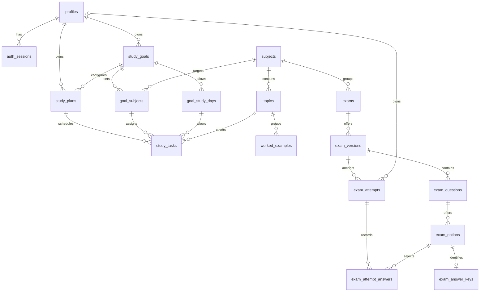

# Thiết kế cơ sở dữ liệu MyStudy

**MyStudy dùng PostgreSQL cho hồ sơ, phiên đăng nhập và dữ liệu nghiệp vụ.** PostgreSQL phù hợp với các quan hệ giữa tài khoản, mục tiêu, lịch học và lượt thi. Khóa ngoại kiểm tra tính nhất quán giữa các bảng, còn giao dịch giúp thay lịch và chốt kết quả thi nguyên tử. [Ràng buộc PostgreSQL](https://www.postgresql.org/docs/16/ddl-constraints.html)

Kiến trúc là `React → API Node.js → PostgreSQL`. API trao đổi mã ủy quyền với Google, xác thực ID token và dùng `sub` để tạo hoặc tìm hồ sơ qua `profiles.google_sub`. Cookie giữ mã phiên ngẫu nhiên, còn PostgreSQL lưu mã băm của phiên và thời điểm hết hạn. Khi triển khai các API nghiệp vụ, dùng `profile_id` của phiên để xác định chủ sở hữu dữ liệu. [Google OpenID Connect](https://developers.google.com/identity/openid-connect/openid-connect)

## Mô hình dữ liệu



| Yêu cầu | Dữ liệu chính |
| --- | --- |
| FR-01, FR-10 · Hồ sơ và dữ liệu theo tài khoản | `profiles` liên kết mỗi `google_sub` với một hồ sơ. `auth_sessions` lưu phiên đăng nhập. `profile_id` xác định chủ sở hữu mục tiêu, lộ trình, nhiệm vụ và lượt thi đã đăng nhập. |
| FR-02, FR-03 · Mục tiêu và quỹ giờ | `study_goals` lưu loại mục tiêu, số tháng và số phút học mỗi ngày. `goal_subjects` lưu điểm từng môn. `goal_study_days` lưu các ngày học theo ISO, từ thứ Hai (`1`) đến Chủ nhật (`7`). |
| FR-04, FR-05 · Lịch học và tiến độ | `study_plans` lưu từng lần tạo lịch và chiến lược. `study_tasks` lưu ngày, thứ tự, chuyên đề, số phút, nội dung học ngắn và thời điểm hoàn thành hoặc hủy lịch. |
| FR-06, FR-07 · Kho đề và bài mẫu | `subjects`, `topics`, `exams`, `worked_examples` lưu danh mục và nội dung. Đề lưu nguồn, thời lượng, đường dẫn đề và hướng dẫn chấm. Đề các năm bắt buộc có năm thi. Bài mẫu lưu đề bài, lời giải, ghi chú và nguồn. |
| FR-08, FR-09 · Thi thử và kết quả | `exam_versions`, `exam_questions`, `exam_options`, `exam_answer_keys` mô tả đề trực tuyến. `exam_attempts` lưu hạn nộp và kết quả. `exam_attempt_answers` lưu tối đa một lựa chọn mỗi câu trong mỗi lượt. |

## Mục tiêu và lộ trình

- Khi lưu, API kiểm tra đúng bốn môn gồm Toán, Ngữ văn và hai môn tự chọn khác nhau, điểm trong khoảng 0–10 và ít nhất một ngày học. Số tháng là số nguyên dương. Quỹ giờ tuần tính từ `daily_minutes × số ngày học ÷ 60`. Ví dụ, `120 × 4 ÷ 60 = 8` giờ. Nếu quỹ giờ thiếu so với ước tính, API trả cảnh báo và vẫn cho tạo lịch.
- Trình xếp lịch áp dụng thứ tự ưu tiên tương ứng với Sát đề hoặc Nền tảng → điểm cao và kiểm tra tổng số phút nhiệm vụ mỗi ngày theo ngân sách học. Khóa ngoại trong PostgreSQL ràng buộc nhiệm vụ vào đúng hồ sơ, môn đã chọn, chuyên đề thuộc môn và ngày học đã chọn.
- Dùng `Asia/Ho_Chi_Minh` để xác định ngày học của MVP. Lưu ngày xếp lịch bằng `date` và thời điểm phát sinh bằng `timestamptz`. Tổng quan đọc nhiệm vụ còn hiệu lực của hôm nay, đếm nhiệm vụ có `completed_at` và tìm ngày gần nhất có nhiệm vụ nếu hôm nay nghỉ. Lộ trình đọc theo khoảng ngày của tuần và sắp theo `position`.
- Tạo lại lịch trong một giao dịch khóa dòng `profiles` của người học. Dùng lại mục tiêu hiện có nếu chỉ đổi chiến lược, hoặc tạo bản mục tiêu mới nếu đổi dữ liệu. Đánh dấu lộ trình cũ đã được thay thế, hủy các nhiệm vụ chưa hoàn thành từ ngày tạo lại và ghi lịch mới. Giữ nguyên nhiệm vụ đã hoàn thành và lịch các ngày trước. Khi lập lại lịch hôm nay, tính thời lượng đã học vào quỹ giờ còn lại và cấp `position` sau các nhiệm vụ được giữ. Chỉ mục duy nhất có điều kiện đảm bảo mỗi tài khoản có tối đa một lộ trình hiện hành.
- Khi đánh dấu đã học, API dùng cùng khóa hồ sơ và cập nhật nhiệm vụ thuộc tài khoản nếu cả `completed_at` và `cancelled_at` còn trống. Yêu cầu gửi lại trả trạng thái đã lưu. Đếm tiến độ trên các dòng đã hoàn thành nên mỗi nhiệm vụ chỉ được tính một lần.

## Kho đề và thi thử

- Kho đề lọc theo `subject_code` và `exam_year`. Kho bài mẫu lọc theo `subject_code` và `topic_id`. API lấy bản có `published_at` và `version_number` lớn nhất để hiển thị nút Thi thử và xác định đề khi bắt đầu. Đề Ngữ văn ở bản đầu có đường dẫn đề và hướng dẫn chấm.
- Mẫu Toán của MVP dùng câu hỏi chọn một đáp án. Trước khi công bố, quy trình nhập nội dung kiểm tra có ít nhất một câu, mỗi câu có ít nhất hai lựa chọn và có đúng một khóa đáp án. Sau khi công bố, giữ nguyên câu hỏi, lựa chọn và đáp án của phiên bản đó. Mọi chỉnh sửa được đưa vào phiên bản mới.
- Khi bắt đầu, API lưu phiên bản, số câu và `expires_at` tính từ thời gian máy chủ cộng thời lượng đề. Trình duyệt hiển thị đồng hồ dựa trên hạn này và lưu từng câu trả lời lên API. Xóa lựa chọn tương ứng với xóa dòng trả lời. Với khách, API cấp token ngẫu nhiên cho lượt thi, lưu hash SHA-256 và kiểm tra token khi truy cập lượt đó.
- Lưu câu trả lời và chốt điểm đều khóa cùng dòng `exam_attempts` bằng `FOR UPDATE`. Sau khi có khóa, kiểm tra trạng thái và thời gian máy chủ. Khi đã hết hạn hoặc đã nộp, lượt thi ngừng nhận thay đổi. Nộp thủ công và tác vụ tự nộp dùng chung giao dịch chấm theo khóa đáp án của phiên bản đã lưu. Giao dịch chỉ ghi kết quả khi `submitted_at` còn trống. Yêu cầu lặp lại trả kết quả cũ. PostgreSQL kiểm tra `đúng + sai + bỏ trống = tổng số câu`. [Khóa dòng PostgreSQL](https://www.postgresql.org/docs/16/sql-select.html#SQL-FOR-UPDATE-SHARE)
- Khi đồng hồ về 0, giao diện yêu cầu nộp. Tác vụ máy chủ quét các lượt quá hạn để chốt cả khi người dùng đóng tab. API trả câu hỏi và lựa chọn trong lúc thi, rồi trả kết quả và khóa đáp án cho chủ lượt thi sau khi chốt. Đường dẫn tài liệu đáp án của kho đề là nội dung công khai theo FR-06.

## Áp dụng schema

Chạy các migration theo thứ tự trên PostgreSQL 16 trở lên. Chạy từ thư mục gốc dự án và đặt `DATABASE_URL` trong shell trước khi gọi `psql`.

```sh
psql "$DATABASE_URL" -v ON_ERROR_STOP=1 -f backend/db/migrations/001_initial.sql
psql "$DATABASE_URL" -v ON_ERROR_STOP=1 -f backend/db/migrations/002_google_auth.sql
psql "$DATABASE_URL" -v ON_ERROR_STOP=1 -f backend/db/migrations/003_email_auth.sql
psql "$DATABASE_URL" -v ON_ERROR_STOP=1 -f backend/db/migrations/004_goal_subjects_and_topics.sql
psql "$DATABASE_URL" -v ON_ERROR_STOP=1 -f backend/db/migrations/005_exam_library.sql
```

Với cơ sở dữ liệu đã tồn tại, chỉ chạy các migration chưa áp dụng. Migration thứ hai giữ nguyên ID và dữ liệu của hồ sơ cũ, chuyển định danh cũ sang `legacy_auth_uid` và thêm `google_sub`. Đăng nhập Google không tự gộp với hồ sơ cũ theo email.

Migration thứ ba thêm cột băm mật khẩu và chỉ mục duy nhất theo email đã chuẩn hóa cho hồ sơ mật khẩu. API hiện xử lý Google OAuth, đăng ký và đăng nhập bằng email, đọc phiên và đăng xuất. Migration thứ tư bổ sung danh mục môn tự chọn, chuyên đề theo thứ tự ôn tập và vị trí hai môn tự chọn của người học. API lịch học dùng phiên đăng nhập để lưu, đọc, tạo lại lộ trình và đánh dấu nhiệm vụ đã học theo từng hồ sơ. Migration thứ năm thêm dữ liệu kho đề và một phiên bản đề luyện Toán công khai. Luồng luyện trong tab chưa dùng các bảng lưu lượt thi; tác vụ máy chủ chốt các lượt quá hạn thuộc phần triển khai sau.
